**[Portfolio](https://harshbuilds.fun) · [LinkedIn](https://www.linkedin.com/in/harsh-tiwari-515467315) · [Email](mailto:harshtiwari1806@gmail.com)**

## Featured projects

## Experience

## Highlights

**Tech:** Python · JavaScript · TypeScript · React · Django · FastAPI · Docker · Linux · Redis · PostgreSQL · n8n · Ollama · Android security
