[LinkedIn](https://www.linkedin.com/in/harsh-tiwari-515467315) · [X](https://x.com/Harsh_Buildzzz) · [Email](mailto:harshtiwari1806@gmail.com)

---

## Selected work

<table>
<tr>
<td width="50%" valign="top">

</td>
<td width="50%" valign="top">

</td>
</tr>
</table>

## GitHub activity

## Experience

**Daikin · SDE Intern** · *June 2026 – August 2026*

Built security automation tools and internal systems to reduce repetitive manual security work.

- **Automated Threat Scanner (SOAR):** Built an n8n workflow that reads security alerts, matches them against 150+ company servers, and checks for exposed network ports. The workflow reduced the reported triage time from around 3 hours to under 30 seconds.
- **Local AI & Chat Memory:** Set up an on-premise AI system using Ollama and Llama 3 with Redis-based memory, allowing internal server data to be queried without sending sensitive company information to an external AI service.
- **Android App Security Auditor:** Built a Python-based tool to decompile enterprise Android applications and identify security issues, excessive permissions, and exposed API keys before release.

## Achievements

- **Smart India Hackathon 2024 — Winner.** Won as part of a multidisciplinary engineering team, building a solution for a real-world problem under a national-level competition.
- **Published research.** Co-authored *AI-Powered Predictive Maintenance Using IoT and Blockchain*, published in the *International Journal of Advance Computational Engineering and Networking (IJACEN)*, Volume 13, Issue 8 (August 2025). [Read the paper](https://iraj.in/journalNEW/IJACEN/paperdetails/22144).

## Tech

**Languages:** Python, JavaScript, TypeScript, C, C++, Bash 
**Frontend:** React, Tailwind CSS 
**Backend & data:** Django, FastAPI, Node.js, Redis, PostgreSQL, SQLite 
**AI & automation:** Ollama (Llama 3), n8n, LangChain, OpenAI API 
**Infrastructure & tools:** Docker, Linux, Git, GitHub, Postman 
**Security & mobile analysis:** Nmap, Androguard, JADX, OWASP MASVS

## Engineering lessons

Writing code matters, but working on real systems made me value the engineering decisions around it just as much:

- Performance and optimization
- Scalability and reliability
- Security and trade-offs
- Explaining a technical idea clearly and showing why it matters
- The ability to sell an idea

A good system solves a problem. A good engineer can also explain why that problem is worth solving.

## Where I think tech is headed

AI is becoming more capable, but engineering is not only about generating code. It is about understanding what people need, translating unclear problems into systems, and making sound decisions around performance, security, reliability, and usability.

**AI can help build the system. Humans still need to decide what should be built.**

---

*Build systems. Solve problems. Keep learning.*

